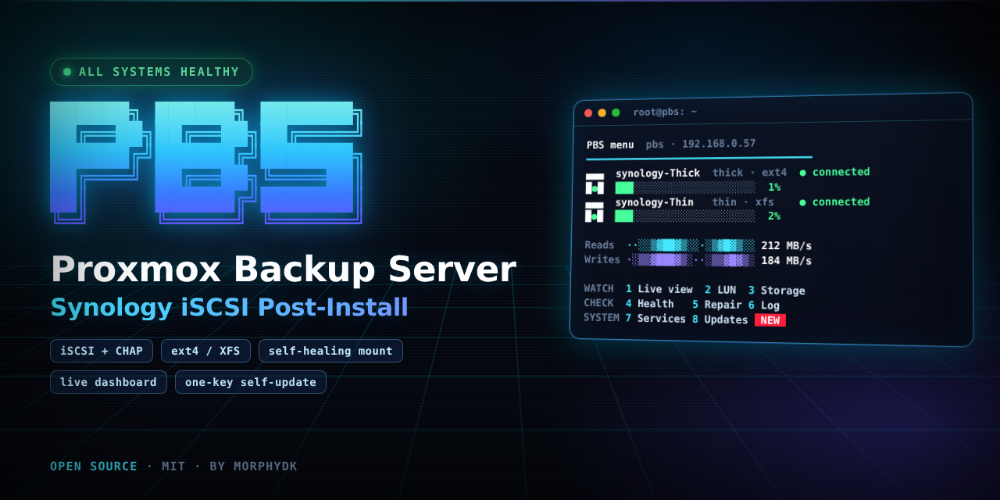
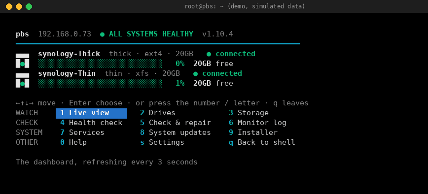

<div align="center">



# Proxmox Backup Server · Synology iSCSI Post-Install

**A guided post-install script for Proxmox Backup Server (PBS): a stable datastore on a Synology iSCSI LUN with CHAP, a self-healing connection, and a login screen that shows you the state of everything.**

*Plain shell menus · CHAP · ext4 or XFS · keeps your data · repairs itself · live login dashboard · one-key self-update*




<sub>Demo with simulated data (example IP and drive names), not a real server.</sub>

[Why](#why-this-exists) · [Features](#features) · [Quick start](#quick-start) · [Synology guide](#step-1--prepare-the-synology) · [The installer](#what-the-installer-does) · [Login screen](#the-login-screen) · [Commands](#command-reference) · [Troubleshooting](#troubleshooting) · [FAQ](#faq)

</div>

---

## Why this exists

Putting a Proxmox Backup Server datastore on a Synology over iSCSI works well, until it doesn't. The usual ways it goes wrong:

- the iSCSI session drops when the Synology updates or restarts, and the filesystem turns **read-only**;
- the disk is not mounted yet when PBS starts, so PBS writes backups to the **system disk** by mistake;
- a wrong or missing CHAP login retries **every minute** and floods the Synology log;
- an existing disk with backups on it gets **formatted by accident**;
- nobody notices a broken connection until the next backup fails.

This script walks you through the whole setup with questions first and changes second, and then keeps watching the connection afterwards.

> **Nothing is changed until you confirm the plan.** All questions come first. A final review screen lists everything the installer is about to do. Disks are only erased if you explicitly choose it and type a confirmation.

---

## Features

### Setup you can follow

- **Plain shell menus**: arrow keys, Enter, number keys. No whiptail or dialog boxes. Black background, colored text, progress bar, live step checklist.
- **Synology guide** before anything is touched: how to create the LUN and target, **thin vs thick**, CHAP, initiator access, MTU.
- **Pick from a list**: the target IQN is discovered from the Synology. You do not copy and paste IQNs.
- **LUN picker** when a target has several LUNs, and the chosen LUN is re-matched by WWN during the install.
- **ext4 or XFS**, with a recommendation based on the LUN size (XFS from 4 TiB).

### Protects your data

- **Detects what is already on the LUN**: empty, an existing filesystem, or an existing **PBS datastore**. You choose to keep it or format it.
- An existing datastore is **re-attached** (PBS 3.3+), so all backups stay.
- Erasing needs an explicit choice **and** a typed confirmation.
- A **write-protected empty mount directory** (`chattr +i`) so nothing can land on the system disk when the LUN is not mounted.
- `/etc/fstab` is **backed up** before every change.

### Stays up

- **Survives a Synology restart or DSM update**: the iSCSI replacement timeout is raised from 2 to **10 minutes**.
- **PBS starts after the mount** (systemd drop-in, `Wants=` and `After=`, so a dead NAS never blocks the web UI).
- **Health monitor every minute**: session, mount, read-only detection, and a real **write test**. It **repairs by itself** (unmount, logout, login, mount, restart PBS) with a cooldown.
- **CHAP-aware**: a rejected login is logged **once** and retried every 15 minutes, not every minute.
- **Alerts** (optional): push message (ntfy or any webhook) or email, only when the state **changes**.
- **Knows thin from thick**: the LUN reports its type, and the installer, `--status` and the login screen show it. **Weekly TRIM** only where it can help (thin LUN with space reclamation), so pruned backups give space back to the Synology. A thin LUN with reclamation switched off in DSM gets a warning.
- Log rotation for the monitor log.

### Knows what is going on

- **Live login dashboard** (MOTD) with the same look as the installer.
- **Update alert**: when packages can be upgraded, the dashboard shows a sharp red, blinking "N UPDATE(S) AVAILABLE" line. Press `u` at login to install them (it lists the packages first and warns if backups are running). Kernel and core updates are flagged, and a **strong reboot warning** follows.
- **Self-update**: once a day the login screen looks on GitHub for a newer release. If there is one, a sharp red "NEW VERSION" line appears. Press `i` and it downloads, checks, saves the old version, installs and tests the new one, and **puts the old one back by itself if anything fails**. Only the login screen and the script are replaced, never your iSCSI, mount or datastore. See [Updating the installer](#updating-the-installer).
- **Live dashboard** (optional login style): stays open and refreshes until you press `q`, with a key bar for menu, log, repair, updates and reboot. On a small console it splits into pages.
- **Live traffic graph**: reads and writes per second as a small graph, plus the average latency to the NAS, in the live views.
- **Interactive menu** (`pbs-menu`): the logo and status stay **frozen at the top** while the menus scroll below. **Drive cards** show every LUN with a small drive icon, thin/thick, filesystem, a usage bar and its connection. The items are grouped, with **badges** for what needs attention (updates, new installer, PBS stopped, a drive with a problem).
- **`--status`** health check you can also run from cron (exit codes 0 / 1 / 2).
- **`--fix-login`** to type the CHAP login again for an installed target.
- **Drives menu**: see the details of every drive, **add another LUN**, or **remove a drive** again (datastore, monitor, mount and iSCSI login) in the safe order. See [Drives: add and remove](#drives-add-and-remove).

### The rest of a post-install

- Switches from the enterprise repository (needs a subscription) to the free **no-subscription** repository, and runs the upgrade.
- Creates the **PBS datastore** (or re-attaches an existing one).
- **Optional, off by default:** removes the **"No valid subscription"** popup, using the "NO NAG" method of the community-scripts post-pbs-install script. You have to tick it in step 2 of the setup.

---

## What you see at login

```
   ██████╗ ██████╗ ███████╗
   ██╔══██╗██╔══██╗██╔════╝   pbs  192.168.0.73
   ██████╔╝██████╔╝███████╗   Proxmox Backup Server  4.2.8
   ██╔═══╝ ██╔══██╗╚════██║   iSCSI storage on Synology
   ██║     ██████╔╝███████║   ● ALL SYSTEMS HEALTHY
   ╚═╝     ╚═════╝ ╚══════╝   pbs-motd v1.10.4 · by MorphyDK
  ━━━━━━━━━━━━━━━━━━━━━━━━━━━━━━━━━━━━━━━━━━━━━━━━━━━━━━━━━━━━━━━━

  ╭─ Server
  │ System         Debian GNU/Linux 13 (trixie) · kernel 7.0.14-25-pve
  │ Uptime         2d 4h 12m   load 0.15 0.10 0.03  (4 cores)
  │ Memory         ██░░░░░░░░░░░░░░░░░░░░░░  10%  404MB of 3.9GB
  │ System disk    ████░░░░░░░░░░░░░░░░░░░░  17%  4.8GB of 28GB
  │ Updates        ✔ up to date (checked 5h ago)
  │ Reboot         (shown in red when a newer kernel is installed than the one running)
  │ Installer      ✔ v1.10.4 · newest version (checked 3h ago)
  ╰─

  ╭─ iSCSI storage · /mnt/synology
  │ Synology       192.168.0.8   DS1821-1.default-target.961c91d51d1
  │ Connection     ✔ connected · waits 10 min for the NAS
  │ Mount          ✔ /dev/sdb1 · 50GB · ext4 · read-write
  │ Space          ████████░░░░░░░░░░░░░░░░░░░░░░  27%
  │                36GB free  · 13GB used of 49GB
  │ LUN type       thin · weekly TRIM gives deleted backups back to the Synology
  │ Monitor        ✔ checks every minute, repairs by itself · last check 12s ago
  │ Last 24 hours  ✔ no problems logged
  ╰─

  ╭─ Backups
  │ Datastore      synology-backup  /mnt/synology
  │ PBS services   ✔ running · web UI https://192.168.0.73:8007
  │ Last backup    OK · 6h ago
  │ Last GC        OK · 25h ago
  ╰─

  Press m for the menu · h for help · or wait 5s
```

The dashboard is read when you log in, so the free space and connection state are always current. Right after a reboot it waits up to 25 seconds for the Synology instead of showing a false alarm.

---

## Quick start

> Run it as **root**, in a terminal, on the Proxmox Backup Server. A window of 80×30 or larger looks best.

```bash
# 1. get the script
wget https://raw.githubusercontent.com/MorphyDK/pbs-synology-iscsi/main/pbs-post-install.sh

# 2. read it first. You are about to run a root script, so that is only sensible.
less pbs-post-install.sh

# 3. run it
chmod +x pbs-post-install.sh
./pbs-post-install.sh
```

The questions take about two minutes. After the review screen the installer runs on its own.

**Requirements**

| Item | Needs |
|---|---|
| Server | Proxmox Backup Server **4.x on Debian 13 "trixie"** (developed and tested on PBS 4.2). Older versions are untested, and re-attaching an existing datastore needs PBS 3.3 or newer |
| NAS | Synology with DSM 7 and **SAN Manager** (iSCSI) |
| Network | Wired, same LAN or VLAN as the Synology. A dedicated NIC or VLAN for iSCSI is best |
| Packages | Installed for you: `open-iscsi`, `parted`, `xfsprogs` (and `curl` if you pick push alerts) |

---

## Step 1 · Prepare the Synology

The installer shows this guide on screen too, but doing it first saves time.

**1. Create the LUN** (DSM › SAN Manager › LUN › Create)

| Setting | Recommendation |
|---|---|
| Name | e.g. `PBS-Backup` |
| Location | The volume that should hold the backups |
| Capacity | PBS deduplicates, but plan room for many versions |
| Allocation | **Thin** or **Thick**, see below |

| | Thin provisioning | Thick provisioning |
|---|---|---|
| Space on the NAS | Only what is actually written | Full size reserved immediately |
| Performance | A little slower | Best and most consistent |
| Space reclamation | **Yes**, pruned backups free space on the NAS (the installer enables weekly TRIM) | No |
| Risk | The NAS volume can fill up if over-committed | Backups can never fail because the NAS is full |
| Choose it when | The volume is shared with other data | The volume is dedicated to backups |

**2. Create the iSCSI target** and map the LUN to it. Turn on **CHAP** and set a username and password (Synology wants 12–16 characters).

**3. Allow only this PBS server.** Give this server's initiator IQN access to the target (the installer shows the IQN after it installs the iSCSI tools). Keep **Allow multiple sessions** disabled.

> ⚠️ **Never connect the same LUN to two servers at the same time.** ext4 and XFS are not cluster filesystems. The data **will** be corrupted.

**Network tips:** use a wired link, and the same MTU on both sides (jumbo frames on both, or on neither).

---

## What the installer does

### Setup (questions only)

| # | Step | What happens |
|---|---|---|
| 1 | Welcome | Shows the server, PBS version and OS |
| 2 | Options | Tick what you want: repository, upgrade, iSCSI, datastore, login screen, and (off by default) popup removal |
| 3 | iSCSI tools | Installs `open-iscsi`, `parted`, `xfsprogs`. Touches no disk |
| 4 | Synology guide | Thin vs thick, target, CHAP, access |
| 5 | Connection | Enter the Synology address, pick the target from a list, enter the CHAP login (tested immediately) |
| 6 | LUN & filesystem | The LUN is inspected read-only. **Keep** the existing data or **format**. Choose ext4 or XFS |
| 7 | Mount, datastore, extras | Mount path, datastore name and path, alerts, login screen style |
| 8 | Review | The complete plan. Start, go back and change something, or quit |

### Installation (runs on its own)

| # | Step | What happens |
|---|---|---|
| 1 | APT repositories | Disables the enterprise repo, adds `pbs-no-subscription` |
| 2 | System upgrade | `apt full-upgrade` |
| 3 | Connect to iSCSI target | Saves the node record with CHAP, boot login and the 10-minute timeout |
| 4 | Prepare disk | New GPT + filesystem, or keep what is there |
| 5 | Mount via `/etc/fstab` | UUID-based line with `_netdev,nofail,x-systemd.device-timeout=30` |
| 6 | Monitoring & boot order | Monitor script + cron, logrotate, systemd drop-ins for PBS, TRIM, alerts |
| 7 | PBS datastore | Creates the datastore, or re-attaches the existing one |
| 8 | Subscription popup | Only if you ticked it: applies the "NO NAG" patch |
| 9 | Login screen | Dashboard, menu and help |
| 10 | Finish | Summary, next steps, optional reboot |

### Existing data on the LUN

The installer opens the LUN **read-only** and tells you what it found:

| Found | What you are offered |
|---|---|
| Empty LUN | Create a GPT partition and a filesystem |
| A filesystem with files | **Keep it** (nothing is touched) or format |
| A filesystem with a **PBS datastore** | Keep it and **re-attach** the datastore: all backups stay |
| Already mounted on this server | Left mounted, only the monitoring and boot order are added |

If you format, the installer shows what would be lost and asks you to type a confirmation.

### ext4 or XFS?

Both are fully supported for PBS datastores. PBS stores backups as many small chunk files.

| | ext4 | XFS |
|---|---|---|
| Good for | The proven Linux default, easy to repair | Big volumes and millions of files |
| Grow later | Yes | Yes (never shrink) |
| Created with | 0% reserved blocks (`-m 0`), so the whole LUN is usable | defaults |
| Recommended | Under 4 TiB | **4 TiB and larger** |

---

## How it keeps the datastore stable

| Problem | What the script does |
|---|---|
| The Synology restarts or updates | The iSCSI replacement timeout is **600 s** (default 120 s). The filesystem waits instead of seeing I/O errors |
| The session drops | The monitor logs in again, mounts, and restarts PBS |
| The filesystem goes read-only | Detected (`ro` mount option and a failed write). Repaired: unmount, logout, login, mount |
| Dead storage that hangs | Every step has a timeout. A stuck write test keeps the lock, so runs never pile up |
| PBS starts before the mount | systemd drop-in: PBS `Wants=` and `After=` the mount unit. A dead NAS still lets the web UI start |
| Backups landing on the system disk | The empty mount directory is immutable (`chattr +i`) |
| Wrong CHAP login | Logged once. Retried only every 15 minutes. Alert sent. Fix with `--fix-login` |
| The installer overwrites a stored login | Stored logins are detected and reused. Saving an empty login is blocked |
| Old leftover iSCSI records | Listed by the installer and `--status`, and can be removed |
| Repair loops | Cooldown of 5 minutes between automatic repairs |
| Alert spam | Alerts only when the state changes (ok → problem, problem → ok) |
| Space not given back | Weekly `fstrim` on thin LUNs with space reclamation. Thick LUNs are recognised and left alone (nothing to give back). Reclamation switched off in DSM is flagged |

---

## The login screen

Enabled by default. Choose a login style during setup (you can change it later in `pbs-menu` › Settings):

| Style | What happens at login |
|---|---|
| **Dashboard + menu prompt** (default) | Dashboard, then a 5 second prompt: `m` menu, `h` help, or your shell |
| **Dashboard only** | Dashboard, then your shell right away |
| **Live dashboard** | Dashboard that stays open and refreshes every 3 seconds. `q` (or Esc, Enter) gives you the shell |
| **Off** | Nothing. `pbs-menu` still works |

In the **live dashboard** a key bar at the bottom shows what you can do: `m` menu, `l` monitor log, `c` check and repair, `h` help, `p` the whole dashboard in a pager, `q` shell. When something is waiting, sharp red keys appear: `u` install updates, `i` install the new installer, `r` reboot. On a small terminal (the Proxmox console is 80x25) the panels are split over pages: `n` or `→` next, `b` or `←` back.

| Command | What it does |
|---|---|
| `pbs-motd` | Shows the dashboard |
| `pbs-motd --live` | The live dashboard with the key bar (`q` quits) |
| `pbs-motd --watch` | Plain live view, refreshes every 3 seconds (`q` quits) |
| `pbs-motd --update-installer` | Look for a newer installer and install it (asks first) |
| `pbs-motd --rollback` | Go back to the version before the last update |
| `pbs-menu` | Interactive menu (or press `m` at login) |
| `pbs-help` | The key commands for iSCSI, storage and PBS (or press `h` at login) |

**The menu** (`pbs-menu`, or press `m` at login)

```
   ██████╗ ██████╗ ███████╗   pbs  192.168.0.57
   ██╔══██╗██╔══██╗██╔════╝   Proxmox Backup Server  4.2.8
   ██████╔╝██████╔╝███████╗   ● ALL SYSTEMS HEALTHY
   ╚═╝     ╚═════╝ ╚══════╝   pbs-motd v1.10.4 · by MorphyDK
  ━━━━━━━━━━━━━━━━━━━━━━━━━━━━━━━━━━━━━━━━━━━━━━━━━━━━━━━━━━━━━━━━
  ▄▄▄  synology-Thick  thick · ext4 · 20GB   ● connected
  █●█  █░░░░░░░░░░░░░░░░░░░░░░░░░░░   1%  20GB free
  ▄▄▄  synology-Thin   thin · xfs · 20GB     ● connected
  █●█  █░░░░░░░░░░░░░░░░░░░░░░░░░░░   2%  20GB free

  WATCH     1 Live view      2 Drives             3 Storage
  CHECK     4 Health check   5 Check & repair     6 Monitor log
  SYSTEM    7 Services       8 System updates [3] 9 Installer [NEW]
  OTHER     0 Help           s Settings           q Back to shell
```

Move with the arrow keys and press Enter, or press the number or letter of an item. The header stays where it is: logos, status pill and the drive cards are redrawn after every action, and everything you open scrolls underneath. On a small terminal (the Proxmox console is 80x25) the header shrinks to one line so the menu still fits. A screen that is longer than the space below the header (for example *Drive details* with several drives, or the health check) is shown **page by page**: space or ↓ for the next page, `b` or ↑ to go back, `q` when done.

| Group | Items |
|---|---|
| **Watch** | 1 Live view · 2 Drives ([submenu](#drives-add-and-remove)) · 3 Storage & datastore |
| **Check** | 4 Health check (the full `--status`) · 5 Check & repair now · 6 Monitor log |
| **System** | 7 Services (status, restart PBS) · 8 System updates (check, install, reboot advice) · 9 Installer update |
| **Other** | 0 Help · key commands · s Settings (login style, update question, installer check, auto-install, refresh speed) · q Back to the shell |

Badges next to an item: red `[!]` on *Drives* and *Check & repair* when a drive has a problem, on *Services* when PBS is not running; `[3]` or `[reboot]` on *System updates*; `[NEW]` on *Installer*.

It only runs for **root** in an interactive terminal. `scp`, `rsync` and scripts are never affected. The original `/etc/motd` is saved as `/etc/motd.pbs-orig`. Turn the screen off with `MODE=off` in `/etc/pbs-motd.conf`, or remove it with `--motd-remove`.

---

## Drives: add and remove

Menu item **2 Drives** (or `pbs-menu`, then `2`) opens a small submenu:

| Entry | What it does |
|---|---|
| **Drive details** | Target, login, session details and disks of every drive. Read-only |
| **Add a drive** | Connects one more Synology LUN: its own mount path, datastore and monitor. Only the drive questions are asked (no repository, upgrade or popup). Same as `pbs-post-install.sh --add-drive` |
| **Change the CHAP login** | Type the username/password again. Same as `--fix-login` |
| **Remove a drive** | Takes a drive away again. Same as `pbs-post-install.sh --remove-drive` |

**Add a drive** suggests `/mnt/synology2` and `synology-backup-2` for the second drive. Use **one iSCSI target per LUN** on the Synology if you can: it keeps each drive independent when one has to be repaired.

**Remove a drive** shows exactly what it will do, and only continues when you type the drive name. In this order:

1. Refuses if a backup, verify, garbage-collection or sync task is running on the datastore.
2. Removes the datastore from PBS. **The backup files stay on the LUN.**
3. Stops the monitor (cron job) so it cannot "repair" the drive you are removing.
4. Unmounts the drive. If it is busy, it shows what uses it and offers to stop PBS for a moment.
5. Removes the `/etc/fstab` line (a copy is kept as `/etc/fstab.backup.<date>`), the empty mount directory and the boot-order file.
6. Logs out of the iSCSI target and deletes its saved settings, **unless another drive uses the same target**.

It never erases data on the LUN and never changes anything on the Synology. Afterwards, remove the storage entry in Proxmox VE (Datacenter › Storage) and check your backup jobs. If you want the space back, delete the LUN on the Synology yourself (SAN Manager › LUN). That deletes the backups on it for good.

If something stops the removal halfway (for example a drive that stays busy), it tells you what was already done. The monitor is put back, and you can run *Remove a drive* again.

---

## Updating the installer

The login screen checks **once a day** whether a newer release of this project exists. That is one small request to `api.github.com` (the newest release tag). Nothing about your server is sent. Turn it off in `pbs-menu` › Settings (or `UPDATE_CHECK=0` in `/etc/pbs-motd.conf`) and it never contacts GitHub.

When a newer version exists:

- the dashboard shows a red **NEW VERSION** line, and at login you can press `i` (also in the live dashboard and in `pbs-menu` › Installer update);
- it shows the versions and asks before it does anything;
- then, in this order: **download** the release file, **check** it (size, bash syntax, and that the version inside matches the release), **save** the installed version in `/var/lib/pbs-motd/backup`, **install**, and **test** the new login screen;
- if any step fails, the saved version is **put back automatically** and that version is not offered again;
- `pbs-motd --rollback` goes back by hand. The last three versions are kept.

Only `/usr/local/sbin/pbs-motd`, `/usr/local/sbin/pbs-post-install.sh` and the login-screen settings are touched. Your iSCSI connection, mount, monitor, datastores and backups are not. Your settings are kept. The run is logged in `/var/log/pbs-motd-update.log`.

**Auto-install** is a separate switch and is **off by default**: with it on, the daily job installs a newer version by itself, with the same checks and rollback. This is a root script on your backup server. Leave it off if you want to read a release before it runs, and install with `i` when you are ready.

The file is downloaded over HTTPS from this repository's release tag. You trust the repository owner, as you do when you run the script the first time.

---

## Command reference

```text
./pbs-post-install.sh                 interactive installer
./pbs-post-install.sh --status        health dashboard, changes nothing
./pbs-post-install.sh --fix-login     type the CHAP username/password again
./pbs-post-install.sh --add-drive     connect one more Synology LUN
./pbs-post-install.sh --remove-drive  remove a drive (datastore, monitor, mount, iSCSI login)
./pbs-post-install.sh --motd          install or update only the login screen
./pbs-post-install.sh --motd-remove   remove the login screen
./pbs-post-install.sh --motd-update   update login screen + script, keep all settings
./pbs-post-install.sh --version
./pbs-post-install.sh --help
```

After the first install a copy lives at `/usr/local/sbin/pbs-post-install.sh`, so `pbs-post-install.sh --status` works from anywhere. **That copy is replaced each time you run a newer file**, so check the version with `--version`.

### `--status`

Checks, per installation: session, stored CHAP login, reconnect wait, mount (read-write?), free space, a **write test**, TRIM, datastore, boot order, the monitor job, the last 24 hours of the monitor log, alerts, and leftover iSCSI records.

| Exit code | Meaning |
|---|---|
| `0` | Healthy (warnings possible) |
| `1` | A problem was found |
| `2` | Not installed / not root |

It prints plain text when piped, so it works in cron:

```bash
0 7 * * * root /usr/local/sbin/pbs-post-install.sh --status >/dev/null || echo "PBS storage problem" | mail -s "PBS" you@example.com
```

---

## What it changes on your system

| Path | Purpose |
|---|---|
| `/etc/apt/sources.list.d/` | Enterprise repo disabled (`Enabled: false`), `pbs-no-subscription.sources` added |
| `/etc/iscsi/nodes/…` | iSCSI node record: CHAP login, `node.startup=automatic`, `replacement_timeout=600` (root-only) |
| `/etc/fstab` | One UUID line with `_netdev,nofail,x-systemd.device-timeout=30`. Backup: `/etc/fstab.backup.<date>` |
| `/usr/local/bin/check-iscsi-session-<name>.sh` | The monitor |
| root crontab | `*/1 * * * *` the monitor |
| `/etc/pbs-iscsi-monitor-<name>.conf` | Alert settings, mode 600 |
| `/var/log/iscsi-monitor.log` | Monitor log. Rotated weekly, 8 weeks (`/etc/logrotate.d/pbs-iscsi-monitor`) |
| `/etc/systemd/system/proxmox-backup{,-proxy}.service.d/10-iscsi-<name>.conf` | PBS starts after the mount |
| `/etc/apt/apt.conf.d/no-nag-script` | Subscription popup patch, only if you chose it. Re-applied after every update |
| `/usr/local/sbin/pbs-motd` + `/usr/local/bin/pbs-{motd,menu,help}` | Login screen |
| `/etc/profile.d/pbs-motd.sh`, `/etc/pbs-motd.conf`, `/etc/cron.d/pbs-motd` | Login hook, its settings, daily update count and installer check |
| `/var/lib/pbs-motd/` | Update counts, the last installer check, the saved versions for `--rollback` |
| `/var/log/pbs-motd-update.log` | What the installer self-update did |
| `/usr/local/sbin/pbs-post-install.sh` | Copy of this script |
| `/var/log/pbs-post-install.log` | Installer log (mode 600) |

---

## Security notes

- The **CHAP password** is stored in the iSCSI node record under `/etc/iscsi/nodes`, readable by root only. open-iscsi needs it to reconnect on its own. It is never written to the logs, and `iscsiadm` masks it when shown.
- The **alert URL** (an ntfy topic name is effectively a password) is stored in a root-only file (mode 600).
- Use a **dedicated CHAP login** for this target, not one you use anywhere else.
- Allow only this server's initiator IQN on the Synology.
- Read the script before running it. It is plain bash, and it runs as root. Do not pipe it into a shell. See [Review it before you run it](#review-it-before-you-run-it).

---

## Review it before you run it

This is a root script that can partition and format a disk, so please read it first. It is plain bash in one file. **Do not pipe it straight into a shell** (`curl ... | bash`); download it, read it, then run it.

Where the things that change a system are, so you can check them in a few minutes:

| What | Where to look |
|---|---|
| Partitions or formats a disk | Only in the function `step_disk`: `grep -n 'wipefs\|parted -s\|mkfs\.' pbs-post-install.sh`. It only runs when you chose *new* or *format*. Formatting an existing disk needs you to type `ERASE` (`confirm_erase`). *Keep* and *already mounted* never reach those commands |
| The LUN inspection | `probe_lun`: opens the disk **read-only** to look for a filesystem or a PBS datastore |
| Mount and `/etc/fstab` | `step_mount`: backs up `/etc/fstab` first, one line per drive |
| The monitor and its repairs | `write_monitor_script` (the generated script) and `step_monitor` (cron, boot order) |
| Removing a drive | `run_remove_drive`: shows the plan, needs the drive name typed, never erases data |
| Updates from GitHub | `installer_update` in the login screen: downloads over HTTPS, checks size, syntax and version, keeps a copy, rolls back on failure |

The plan screen before the installation lists every change. Nothing is touched before you confirm it. **Test on a spare LUN first if you can, and run a real restore before you rely on any backup setup.** What was and was not tested is listed under [Tested, and not yet tested](#tested-and-not-yet-tested).

---

## Troubleshooting

<details>
<summary><b><code>apt update</code> fails with <code>401 Unauthorized</code> from <code>enterprise.proxmox.com</code></b></summary>

The enterprise repository needs a paid subscription. The installer switches it off before its first `apt update`. To do it by hand:

```bash
for f in $(grep -rl enterprise.proxmox.com /etc/apt/sources.list.d/); do mv "$f" "$f.disabled"; done
cat > /etc/apt/sources.list.d/pbs-no-subscription.sources <<'EOF'
Types: deb
URIs: http://download.proxmox.com/debian/pbs
Suites: trixie
Components: pbs-no-subscription
Signed-By: /usr/share/keyrings/proxmox-archive-keyring.gpg
EOF
apt update
```
</details>

<details>
<summary><b>Synology log: <code>failed to login … due to CHAP required but absent</code>, once a minute</b></summary>

The stored CHAP login is missing or empty. Run `pbs-post-install.sh --fix-login`, then `--status`. The monitor now waits 15 minutes between attempts after a rejected login, so a wrong password cannot flood the log.
</details>

<details>
<summary><b>The login screen shows red "not connected" lines</b></summary>

If the server just booted, wait a minute. The dashboard waits up to 25 seconds and shows only a yellow note in the first minutes. If it stays red: `pbs-menu` › **Check & repair now**, then look at `journalctl -b -u iscsid -u open-iscsi`.
</details>

<details>
<summary><b>The mount is read-only</b></summary>

The filesystem hit an I/O error, usually after a long NAS outage. The monitor repairs it automatically within a minute or two. By hand: `pbs-menu` › **Check & repair now**.
</details>

<details>
<summary><b>The installer seems stuck on "Upgrading packages"</b></summary>

The spinner shows minutes:seconds and the last line of output. After 5 minutes of silence it turns yellow. Check `ps aux | grep -E 'apt|dpkg'` and `tail -30 /var/log/pbs-post-install.log`.
</details>

<details>
<summary><b>The status check shows a yellow warning</b></summary>

Read the line with `⚠`. Common ones: free space over 85 %, `fstrim.timer` not running, or a leftover iSCSI record. A normal reconnect after a reboot is **not** counted as a problem.
</details>

<details>
<summary><b>The subscription popup came back after an update</b></summary>

The apt hook re-applies the patch after every package change. If a PBS update changes the web UI code, the pattern may stop matching. Re-run the installer, or: `apt --reinstall install proxmox-widget-toolkit`, then reload the browser with Ctrl+Shift+R.
</details>

<details>
<summary><b>Where are the logs?</b></summary>

| Log | Where |
|---|---|
| Installer | `/var/log/pbs-post-install.log` |
| Monitor | `/var/log/iscsi-monitor.log` |
| iSCSI | `journalctl -u iscsid` |
| PBS | `journalctl -u proxmox-backup-proxy` |
</details>

---

## FAQ

**Does it erase my disk?**
Only if you choose *format* and type the confirmation. *Keep* touches nothing.

**Can I re-run it?**
Yes. It detects a mounted LUN, keeps a stored CHAP login, corrects an outdated `/etc/fstab` line, and re-attaches an existing datastore. To only update the login screen, use `--motd`.

**Does it work with more than one LUN or target?**
Yes. `--status`, the menu and the dashboard handle several installations. A target with several LUNs shows a picker.

**Can I skip parts?**
Yes. Step 2 of the setup lets you untick the repository switch, the upgrade, iSCSI, the datastore and the login screen. The popup removal is off unless you tick it.

**Why not whiptail?**
Plain shell menus are lighter, work over any SSH session, and look the same everywhere.

**Is the popup removal OK?**
It is optional and off by default. It is the community-maintained approach, and it keeps the software working. If PBS is useful to you, please consider a subscription to support its developers.

**Other NAS brands?**
It is written for Synology (the guide, the CHAP limits, the IQN style). Any iSCSI target should work with the same commands, but only Synology is tested.

---

## Undo

```bash
./pbs-post-install.sh --motd-remove                   # login screen

# monitor + boot order (replace <name> with your mount directory name, e.g. synology)
crontab -l | grep -v "# iSCSI monitor for <name>$" | crontab -
rm /usr/local/bin/check-iscsi-session-<name>.sh /etc/pbs-iscsi-monitor-<name>.conf
rm /etc/systemd/system/proxmox-backup{,-proxy}.service.d/10-iscsi-<name>.conf && systemctl daemon-reload

# popup patch
rm /etc/apt/apt.conf.d/no-nag-script && apt --reinstall install proxmox-widget-toolkit

# disk and connection: unmount, remove the fstab line, then
chattr -i /mnt/<name>
iscsiadm -m node -T <target-iqn> -p <portal> --logout
iscsiadm -m node -T <target-iqn> -p <portal> -o delete
```

The easy way for one drive: `pbs-menu` › **2 Drives** › **Remove a drive** (or `pbs-post-install.sh --remove-drive`), see [Drives: add and remove](#drives-add-and-remove). The manual steps above are what it does for you.

The datastore itself is removed in the PBS web UI (Datastore › Remove). That does not delete the backups on the LUN.

---

## Tested, and not yet tested

**Developed and run against:** Proxmox Backup Server 4.2.x on Debian 13 (trixie), a Synology NAS over iSCSI with CHAP, one thin and one thick LUN (ext4), with TRIM and the login dashboard on two drives.

**Run by the author on a real setup:** the full installation on Proxmox Backup Server 4.2 with a Synology NAS, tested and in use. **Run on real hardware (v1.10.x):** the self-update from GitHub (v1.9.1 → v1.9.2 → v1.9.3 → v1.10.0, press `i`), *Remove a drive* and *Add a drive* on a Synology. The rollback after a failed update, a file with the wrong version or a syntax error (refused), no network, auto-install and `--rollback` were tested against a simulated GitHub only. *Remove a drive* was also run against simulated tools for the edge cases: a running task (refused), PBS refusing the datastore removal, a busy drive, and two drives on one target.

**Not yet verified on real hardware:** what happens through a full DSM update/reboot with a backup running, the automatic repair after a long outage, and XFS on very large LUNs. **Please test restores before you rely on any backup setup**, and open an issue if something behaves differently on your system.

`shellcheck` is clean on v1.10.2 and later for the installer and the generated login screen (`pbs-motd`). The monitor script of a drive set up with an older version keeps its old text (one harmless note about an unused loop variable) until you run the installer for that drive again.

---

## Roadmap

- Backblaze B2 as a remote datastore (PBS S3 datastores, tech preview)
- Datastore prune and garbage-collection presets
- `--uninstall` (remove everything this script added) and `--dry-run`

---

## Credits & license

- Inspired by **Derek Seaman's** guide, [How To: Synology iSCSI LUN for Proxmox Backup Server Datastore](https://www.derekseaman.com/2025/08/how-to-synology-iscsi-lun-for-proxmox-backup-server-datastore.html). If you prefer the manual, step-by-step way, start there.
- The "NO NAG" popup method comes from the **community-scripts** post-pbs-install script (MIT).
- Written by **MorphyDK**, with the help of Claude.

Released under the **MIT License**. Use it at your own risk. Always keep a second copy of data that matters.

*This is an independent community project. It is not affiliated with or endorsed by Proxmox Server Solutions GmbH or Synology Inc. Proxmox, Proxmox Backup Server and Synology are trademarks of their respective owners.*

Found a security problem? See [SECURITY.md](SECURITY.md).

<div align="center">

**If this saved you a weekend of debugging, a ⭐ on the repo is very welcome.**

</div>
